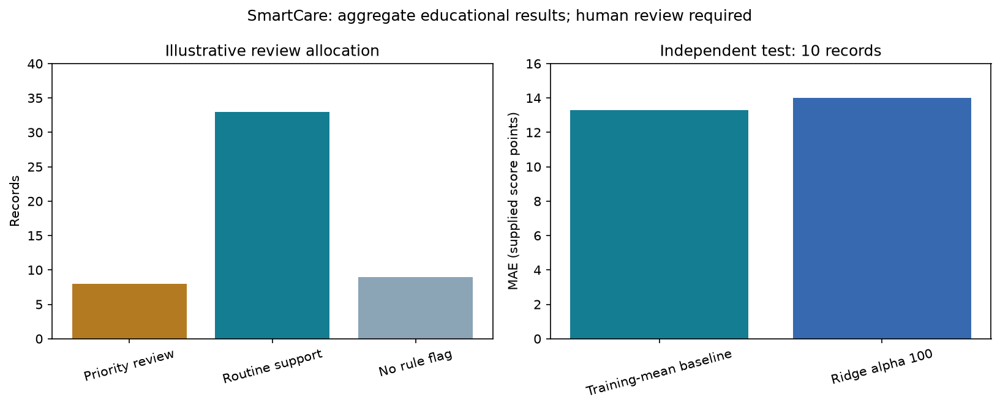
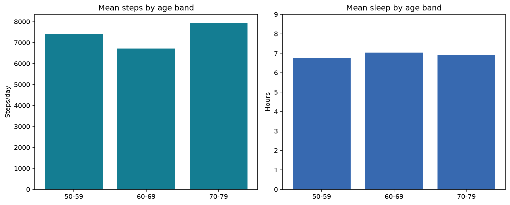

# SmartCare aggregate health analytics

An academic data and visualisation portfolio project by Ming Zhao, developed for MBI806 at Yoobee College. Public edition: reports, assessment briefs, student identifiers, videos, credentials and row-level sensitive data are excluded.

A 50-record academic smartwatch analysis with an unchanged 40 training / 10 testing experiment. Transparent review allocation is separate from score regression. Ridge test MAE is 13.99 versus 13.30 for a training-mean baseline, so the project does not support automated clinical decisions.





## Explore

- `data/`: aggregate CSVs and source/denominator notes.
- `src/`: data processing and modelling methods; `render_public_charts.py` runs using the included aggregates.
- `visuals/`: presentation-ready aggregate figures.
- `powerbi/Portfolio/Portfolio.pbip`: a fresh aggregate-only native Power BI project (2 pages, 6 tables). Open in Power BI Desktop, refresh embedded tables, then save as PBIX. It contains no original row-level cache.
- `presentations/`: public presentation material, without reports or student numbers.

```bash
pip install -r requirements.txt
python src/render_public_charts.py
```

Full pipeline inputs are intentionally not redistributed. Follow `data/README.md` to obtain authorised source data locally. Published notebooks have outputs cleared to avoid releasing record-level results. Aggregate outputs and original methods are distinct from the new public dashboard's presentation layout.

## Limits

This is educational work, not an employer project or a production system. It makes no claim of an awarded grade, realised financial benefit or clinical effectiveness. See `data/README.md` for provenance, privacy, source licence and interpretation limits.

